<div align="center">

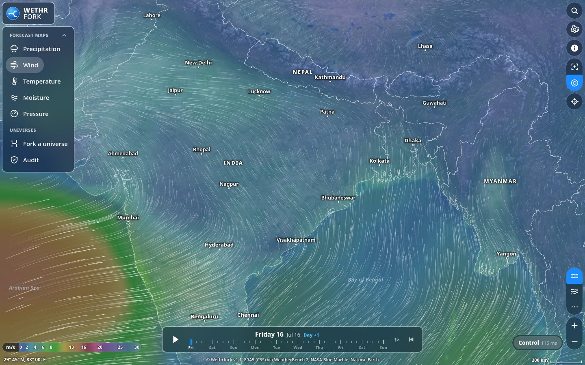

<br><br>

# Wethrfork

**A weather model with a speed limit.**

A Climate Digital Twin of India that forecasts the monsoon ten days ahead, forks it into alternate universes when you
shock it, and holds every shock to a measured speed limit of 8 grid cells (about 900 km) per day.

<br>


[](https://github.com/HARDIKSINGH150206/Wethrfork/actions/workflows/ci.yml)


Yugaantar DevForge &nbsp;·&nbsp; Track 2: *Multiverse of Monsoon* &nbsp;·&nbsp; Team Return0

[Highlights](#highlights) &nbsp;|&nbsp; [Product tour](#product-tour) &nbsp;|&nbsp; [How it works](#how-it-works) &nbsp;|&nbsp; [Results](#results-and-validation) &nbsp;|&nbsp; [Testing](#testing-and-quality-gates) &nbsp;|&nbsp; [Getting started](#getting-started) &nbsp;|&nbsp; [Limits](#known-limits)

</div>

---

## Highlights

| Capability | Description |
|---|---|
| **Ten-day forecast for South Asia** | Six physical channels (temperature, rain, two wind components, pressure, moisture) on a 32 × 36 grid of 1° cells, 6.5–37.5° N and 65.5–100.5° E, from three days of past weather. |
| **Forks into alternate universes** | Apply any localized shock (a warmer Bay of Bengal, a stalled monsoon, a planted cyclone, a heat dome, or a box you draw) and watch the alternate forecast diverge from the control. |
| **A measured speed limit** | The shock-response network can move information at most 8 cells per day. Its architecture enforces the bound, and unit tests and a 120-shock stress test confirm it: zero change outside the limit. |
| **Beats both references** | On 2021 (never seen by the networks) the forecast beats the better of persistence and climatology: mean skill **0.135**, full marks at 0.12. It beats persistence at day 4 on every channel. |
| **Passes the judge's own checks** | Both official shocks score **15 / 15** causality points on all 71 held-out windows and in every season. A zero shock returns the unshocked forecast bit for bit. |
| **Fast and offline** | A shocked 10-day forecast takes about 0.12 s on 4 CPU threads, with no GPU, no network and a read-only repository. |
| **Audited live** | Every fork in the dashboard runs the official causality checks on the spot and reports rainfall exposure by region. |
| **Tested like the judge** | A judge-like container scores 120 calls with the organisers' own client and scoring code. Five deliberately broken servers were all rejected. |

### Results at a glance

<picture>
  <source media="(prefers-color-scheme: dark)" srcset="docs/images/charts/score-dark.png">
  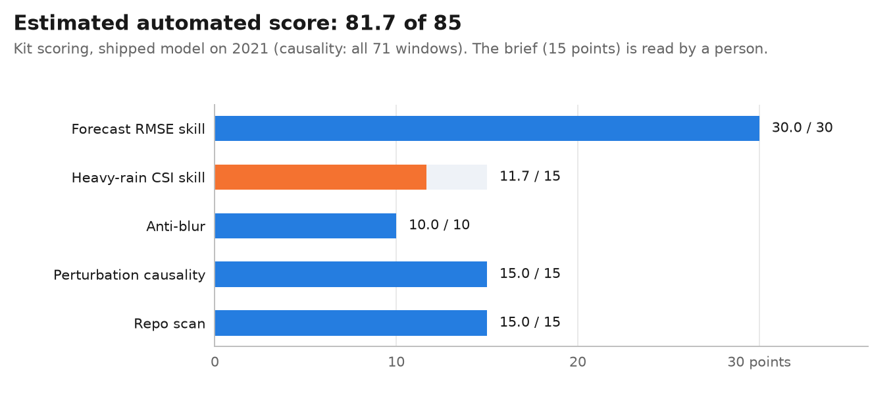
</picture>

| Measure (organisers' scoring code) | Wethrfork | Full marks at | Points |
|---|---|---|---|
| Forecast RMSE skill (2021, out of sample) | **0.135** | 0.12 | 30 / 30 |
| Heavy-rain CSI skill at 10 mm/day (2021, out of sample) | **0.073** | 0.10 | 11.0 / 15 |
| Day-8 variance ratio, lowest channel (anti-blur) | **0.71** | 0.40 | 10 / 10 |
| Perturbation causality, both official shocks, 71 windows | **15.0 in every window** | — | 15 / 15 |
| Repo scan (anti-cheat and code health) | **15.0, no flags** | — | 15 / 15 |
| Brief | two pages, `brief/wethrfork-brief.pdf` | — | judged by a person |

*Out of sample* means the networks and ridge were trained on 2005–2019 and the calibration was fitted on 2020 only,
then graded on 2021. The shipped calibration is refit on 2020–2021, which gives 0.134 and 0.079 on 2021 (the chart above). See
[Data splits](#data-splits).

---

## Product tour

Every image below is live output from our own forecast server on a real start state. Nothing is pre-rendered.

### Forecast maps

Five forecast maps over a NASA Blue Marble base map with Natural Earth borders (India's official boundaries), animated
wind particles, pressure lines, a 6-hourly timeline and a scale bar. It works with Wi-Fi off.

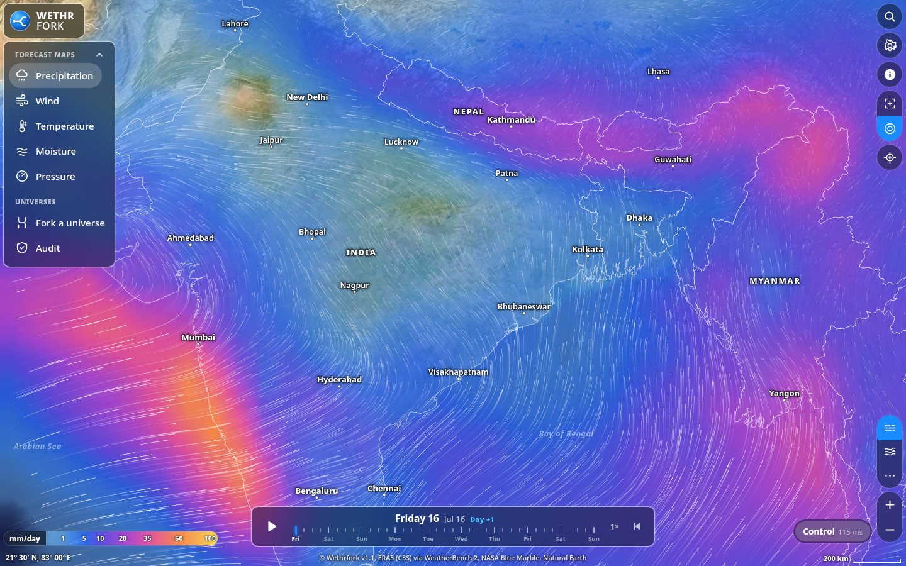

### Fork a universe

Pick a preset or draw a box, choose a channel and an amount, and fork. The control run and every universe appear as
runs at the bottom right, like forecast models on a weather map.

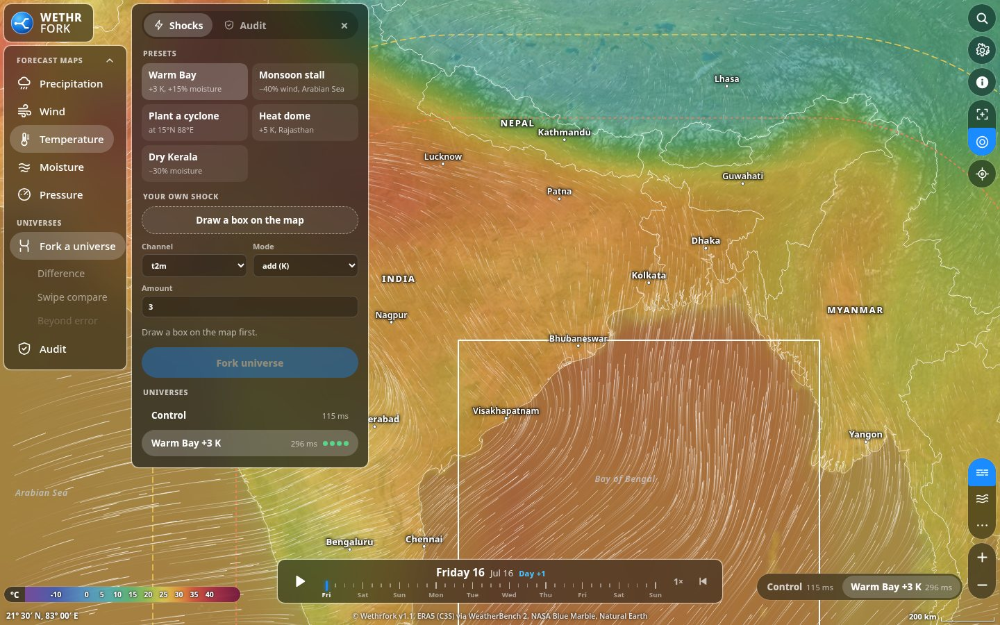

### Difference and the speed-limit rings

*Difference* shows the universe minus the control. The rings show how far the change may travel by the selected
day: the inner ring is the 8-cells-per-day limit and the outer ring is the judge's radius. Day 4 of a +3 K Bay of Bengal shock is shown.

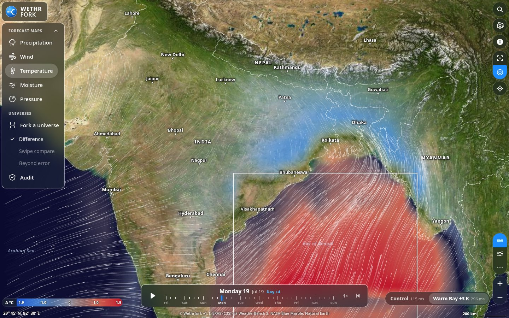

### Swipe compare

Drag the divider: control on the left, the universe on the right.

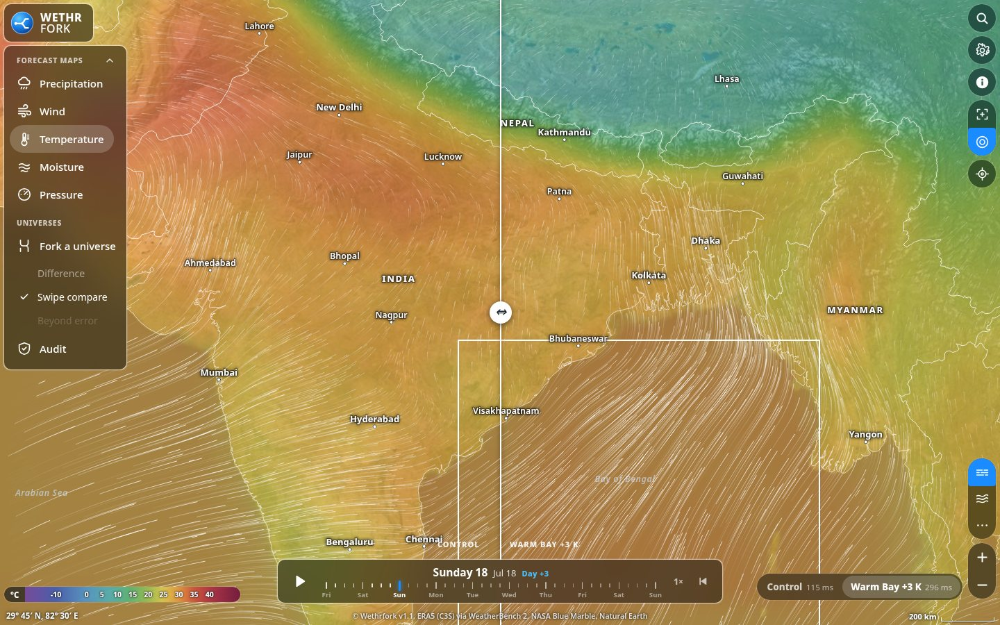

### Limits verdict and rainfall exposure

The **Audit** panel runs the official checks live on every fork (non-zero, localized, propagates, stable) and flags
inputs far from anything the model was trained on. **Rainfall exposure** compares 3-day accumulated rain, and the share
of land above a threshold you choose, by region.

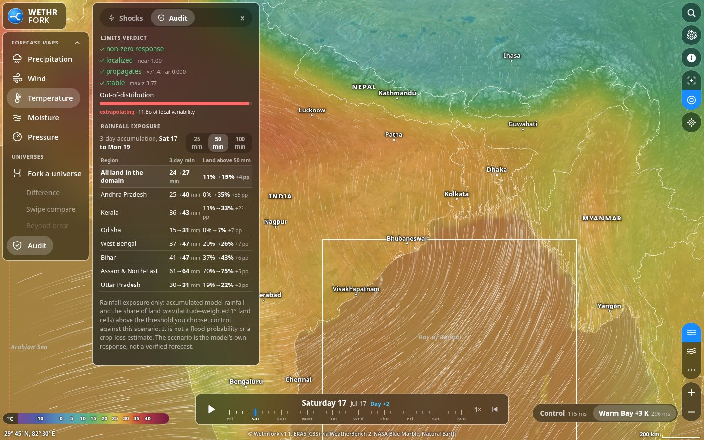

### Point forecast

Click anywhere for a value readout and a ten-day meteogram for that point, universe against control.

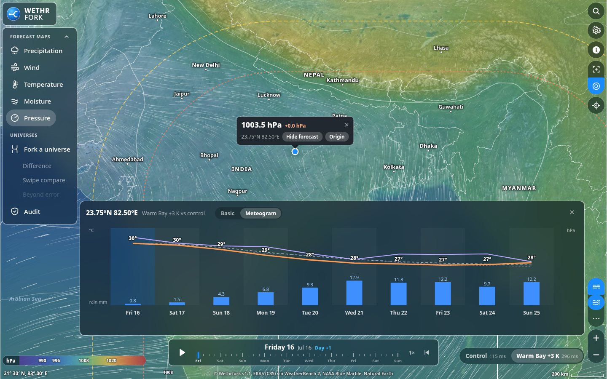

### Timeline Prime, Validation and About

*Timeline Prime* plays the forecast against what actually happened on a held-out window. *Validation* shows every
measured claim: skill by lead and channel, the causality gate, the fuzz test and the natural experiment. *About* is
the model card with its limits.

<table>
  <tr>
    <td width="50%">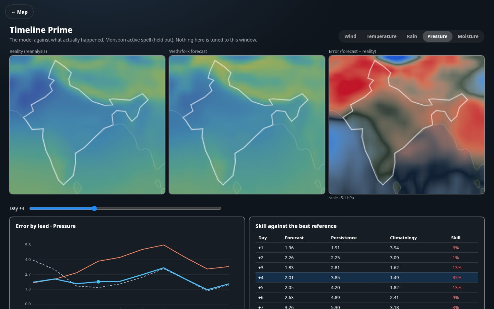</td>
    <td width="50%">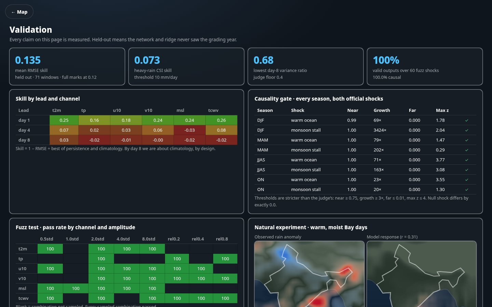</td>
  </tr>
  <tr>
    <td width="50%">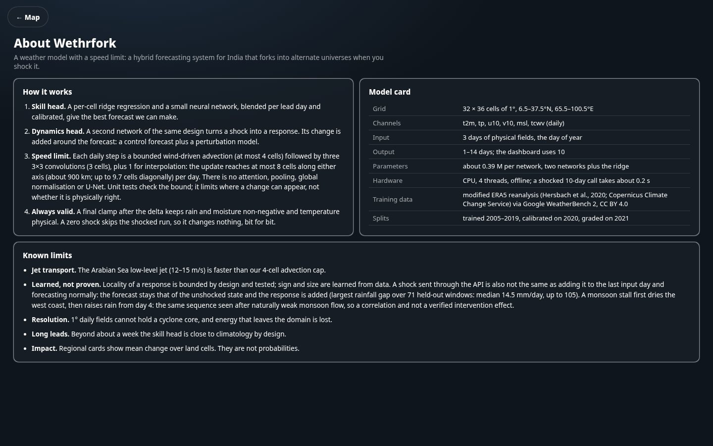</td>
    <td width="50%" align="center">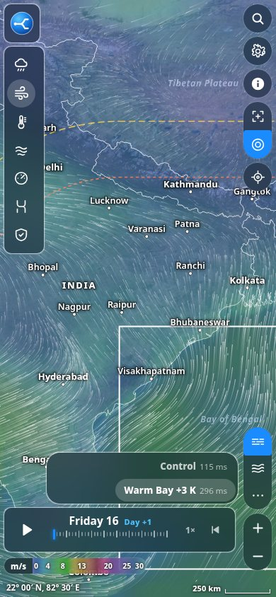</td>
  </tr>
</table>

> Regenerate the screenshots with `python scripts/capture_readme_screenshots.py` while `make demo` is running, and the
> charts with `python -m evaluation.readme_figures` after `make release-check`.

---

## Table of contents

- [Problem statement](#problem-statement) · [Solution overview](#solution-overview) · [Who it is for](#who-it-is-for)
- [How it works](#how-it-works) · [Architecture](#architecture) · [API](#api)
- [Results and validation](#results-and-validation) · [Testing and quality gates](#testing-and-quality-gates)
- [Tech stack](#tech-stack) · [Repository structure](#repository-structure) · [Getting started](#getting-started)
- [Known limits](#known-limits) · [Roadmap](#roadmap) · [Documentation](#documentation) · [Credits and licence](#credits-and-licence)

## Problem statement

- India's monsoon decides water, food and lives for over a billion people, yet "what if" questions (a warmer Bay of
  Bengal, a weaker monsoon jet, a cyclone in a different place) are answered today with large physics models that
  take supercomputers and hours.
- Track 2 asks for a **digital twin**: a model that forecasts India's weather from a few days of real data **and**
  answers what-if questions by responding to a localized shock.
- An automated judge runs the server offline on 4 CPUs and scores it with public code. The forecast must beat
  persistence and climatology. Shocks must start local, spread outward no faster than about 8 cells per day, and stay
  numerically stable. A zero shock must change nothing. Every answer must arrive in under 5 seconds.
- Most machine-learning weather models look at the whole map at once (U-Nets, attention, global normalisation). A
  shock in the Bay of Bengal then moves the whole map on the first day, which fails the judge's locality test and
  makes the answer meaningless as a what-if.

## Solution overview

Wethrfork splits the job in two. A **skill head** makes the best forecast it can: a per-cell ridge regression blended
with a small neural network, then calibrated per lead day. A **dynamics head**, a second network of the same design,
answers the what-if: it runs on the shocked and unshocked states, and only its *difference* is added to the forecast.
That network is local by construction. Each day it moves information by a bounded advection (at most 4 cells,
capped smoothly with `tanh`) and then three 3 × 3 convolutions (3 more cells), plus 1 for interpolation. So a change
can travel at most 8 cells per day along either axis, about 900 km. It uses no attention, pooling, global
normalisation or U-Net. A final clamp keeps rain and moisture non-negative and temperature physical. A zero shock
skips the shocked run entirely, so it changes nothing, bit for bit.

The dashboard turns this into an instrument: fork the weather, watch the change spread inside its rings, and read the
official verdict and the rainfall exposure on the spot.

## Who it is for

- **Disaster-management and planning teams:** compare a control forecast with a shocked one and read the change in
  rainfall exposure by state before the season unfolds.
- **Researchers and students:** a transparent, fast, CPU-only twin whose limits are measured and stated, not hidden.
- **Hackathon judges:** apply any shock live and see the official checks run on it within a second.

---

## How it works

### The served formula

```text
forecast = clamp( PP( Blend( ridge(x), net(x) ) )  +  [ dyn(x + shock) − dyn(x) ] )
```

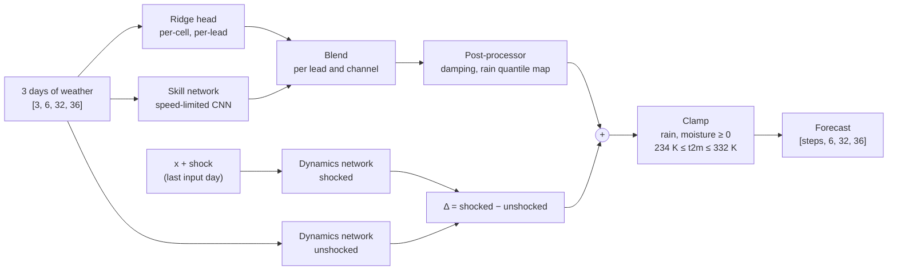

- **Skill head (forecast).** A per-cell ridge regression (7.8 MB) and a 0.39 M-parameter network, blended per lead day
  and channel. They are then damped toward climatology at long leads, so the day-8 forecast is never worse than
  climatology. Rain is quantile-mapped so heavy rain is not washed out.
- **Dynamics head (what-if).** A second 0.39 M-parameter network of the same architecture, fine-tuned on large shocks that
  touch the domain edge. Both shocked and unshocked states run through it as one batch, and only the difference is used.
  The ridge never contributes to a shock, because it is per-cell and would trap the response inside the box.
- **Network step.** Residual on the last day: bounded semi-Lagrangian advection (displacement length capped at 4
  cells/day with `tanh`, replicate padding, `grid_sample` with border padding), then a local CNN with 3 × 3 kernels
  only. Circular padding, dilations, attention, pooling and global normalisation are excluded by rule and by test.

### The speed limit, measured

<picture>
  <source media="(prefers-color-scheme: dark)" srcset="docs/images/charts/light-cone-dark.png">
  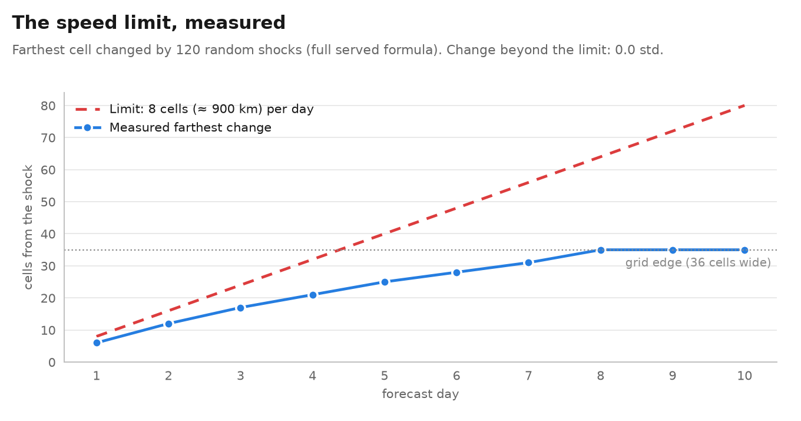
</picture>

| Forecast day | 1 | 2 | 3 | 4 | 5 | 6 | 7 | 8 | 9 | 10 |
|---|---|---|---|---|---|---|---|---|---|---|
| Farthest change (cells, max over 120 shocks) | 6 | 12 | 17 | 21 | 25 | 28 | 31 | 35 | 35 | 35 |
| Limit (8 × day) | 8 | 16 | 24 | 32 | 40 | 48 | 56 | 64 | 72 | 80 |

The 120 shocks cover every channel, both signs, 0.5 to 8 standard deviations, single cells and patches, and corners
and edges. They run through the full served formula. The largest change outside the limit is **0.0**. From day 8 the
curve stops at 35 because the grid is 36 cells wide. Three fresh processes give bit-identical results.

### Data splits

| Use | Years |
|---|---|
| Networks and ridge weights | 2005–2019 |
| Blend, damping, rain calibration, checkpoint choice | 2020 |
| Reported out-of-sample skill | 2021 (held out) |
| Shipped calibration | refit on 2020–2021, weights unchanged |
| Climatology and normalisation | 2005–2021, as the judge's reference does (rebuilding without 2021 moves skill from 0.1335 to 0.1326) |

Data: ERA5 reanalysis averaged to daily 1° fields by the organisers (`india_climate_train.nc`, 6,209 days, 2005–2021).
It is never committed; a dataset audit checks it before use (21 / 21 checks, no NaN, contiguous days, no leakage).

---

## Architecture

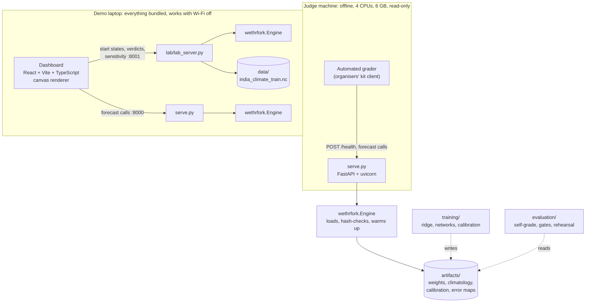

| Component | Path | Role |
|---|---|---|
| Inference server | `serve.py` | The only file the judge runs and the only file with the API route. Loads the engine once, then serves `POST /health` and the forecast call. |
| Model package | `wethrfork/` | Engine, network, ridge, blend, post-processor, clamps, wire decoding. Imports only allowed libraries (tested). |
| Artifacts | `artifacts/` | 21 MB of committed weights and calibration, checked against `manifest.json` hashes at start-up. |
| Lab server | `lab/` | Science panels for the dashboard: start states, live verdicts, sensitivity, fuzz and natural-experiment results. |
| Dashboard | `dashboard/` | Full-screen map, forks, audit, point forecast, Timeline Prime, Validation, About. Offline, system fonts, no tiles. |
| Training | `training/` | Climatology, ridge, both networks, blend, post-processor, error maps; `make artifacts` rebuilds everything. |
| Evaluation | `evaluation/` | Self-grade, causality gate, sweep, fuzz, stress tests, dataset audit, judge rehearsal, release check, charts. |

## API

The judge contract (`docs/04-api-spec.md`), in physical units, as plain nested JSON lists:

| Endpoint | Request | Response |
|---|---|---|
| `POST /health` | — | `{"status": "ready", "model_name": "wethrfork-v1.1-speedlimit"}` once loaded and warmed up |
| `POST /simulate` | `init_states [3,6,32,36]` oldest first · `doy_sincos [sin, cos]` of the last input day · `steps` 1–14 · `perturbation [6,32,36]` or `null` | `rollout [steps,6,32,36]` (day k+1 after the last input day) · `inference_ms` |

Channels in order: `t2m` (K), `tp` (mm/day), `u10` (m/s), `v10` (m/s), `msl` (Pa), `tcwv` (kg/m²). The perturbation is
added to `init_states[-1]` exactly as given. Malformed requests get a clear `400`/`422`. Extreme but valid inputs
still get a valid forecast.

---

## Results and validation

All numbers come from the organisers' own scoring code (`monsoon_r1.scoring`). Every chart is drawn from a measured
report by `evaluation/readme_figures.py`.

### Forecast skill

<picture>
  <source media="(prefers-color-scheme: dark)" srcset="docs/images/charts/skill-by-lead-dark.png">
  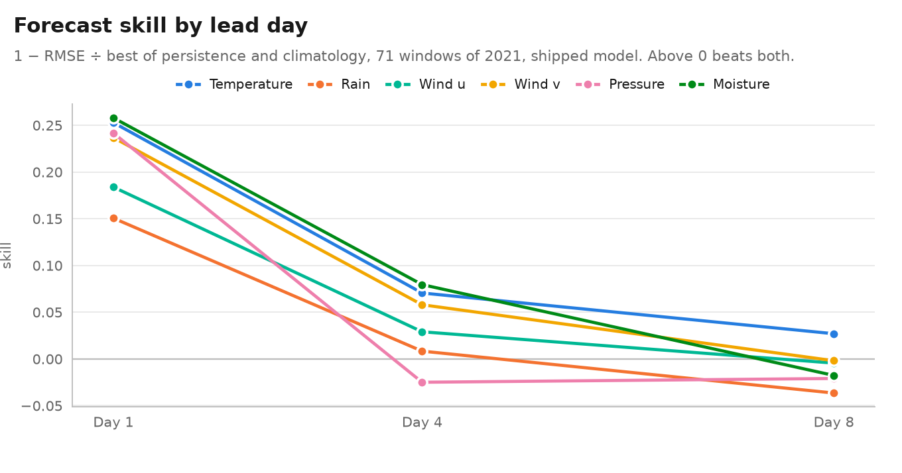
</picture>

Shipped model on the 71 windows of 2021 (the networks never saw 2021; the shipped calibration includes it):

| Skill vs best reference | Temperature | Rain | Wind u | Wind v | Pressure | Moisture |
|---|---|---|---|---|---|---|
| Day 1 | 0.253 | 0.151 | 0.184 | 0.237 | 0.242 | 0.258 |
| Day 4 | 0.070 | 0.008 | 0.029 | 0.058 | −0.025 | 0.079 |
| Day 8 | 0.027 | −0.037 | −0.005 | −0.002 | −0.021 | −0.018 |

Skill comes mainly from days 1 to 4. By day 8 the forecast is damped toward climatology by design, so it stays close to
the stronger reference instead of drifting. Heavy-rain CSI skill by lead: 0.099 (day 1), 0.021 (day 4), −0.005 (day 8).

<picture>
  <source media="(prefers-color-scheme: dark)" srcset="docs/images/charts/day4-vs-persistence-dark.png">
  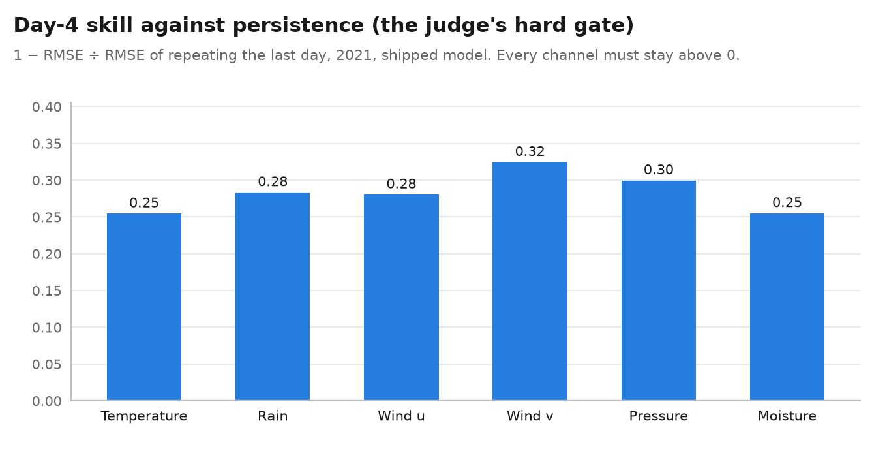
</picture>

The judge's hard gate is to beat "repeat yesterday" at day 4. We beat it on **every** channel: 0.255, 0.283, 0.280, 0.324, 0.299, 0.255.

### Anti-blur

<picture>
  <source media="(prefers-color-scheme: dark)" srcset="docs/images/charts/variance-ratio-dark.png">
  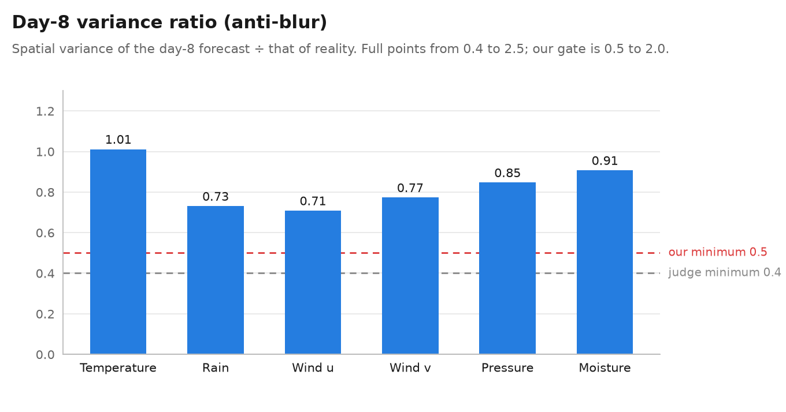
</picture>

Day-8 spatial variance against reality: 1.01, 0.73, 0.71, 0.77, 0.85, 0.91. Every channel is inside our band of 0.5 to
2.0, which is stricter than the judge's 0.4 to 2.5. The forecast keeps the structure of the weather instead of smoothing it away.

### Causality: local first, then outward

<picture>
  <source media="(prefers-color-scheme: dark)" srcset="docs/images/charts/causality-near-dark.png">
  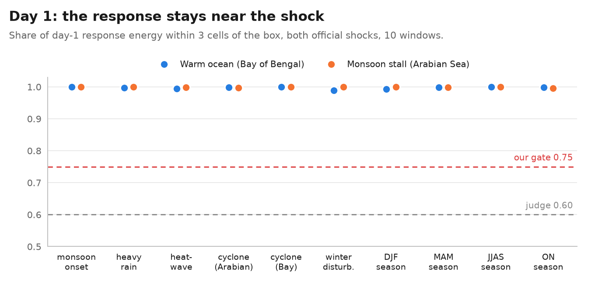
</picture>

<picture>
  <source media="(prefers-color-scheme: dark)" srcset="docs/images/charts/causality-growth-dark.png">
  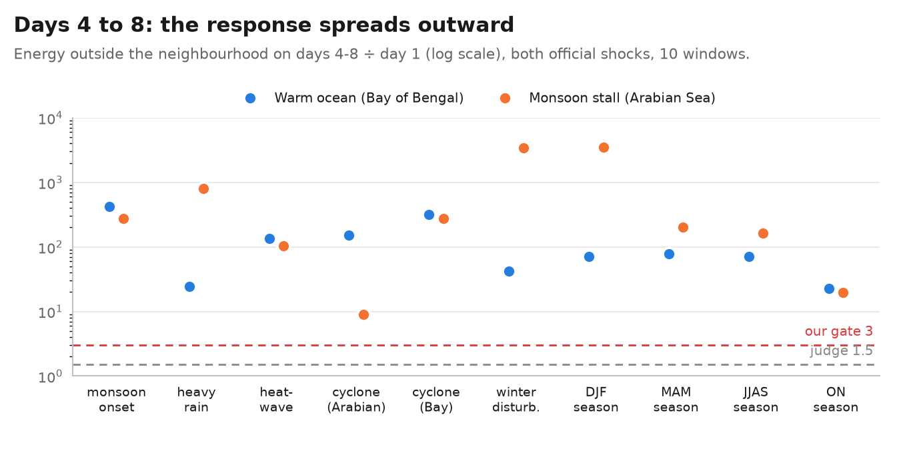
</picture>

| Season | Warm ocean: near / growth / max z | Monsoon stall: near / growth / max z | Null shock |
|---|---|---|---|
| DJF | 0.99 / 69× / 1.78 | 1.00 / 3424× / 2.04 | 0.0 |
| MAM | 1.00 / 79× / 1.47 | 1.00 / 202× / 0.29 | 0.0 |
| JJAS | 1.00 / 71× / 3.77 | 1.00 / 163× / 3.08 | 0.0 |
| ON | 1.00 / 23× / 3.55 | 1.00 / 20× / 1.30 | 0.0 |

The judge requires near ≥ 0.60, growth ≥ 1.5 and max z ≤ 5. Our gate requires near ≥ 0.75, growth ≥ 3, far-field energy
≤ 0.01 and max z ≤ 4, plus the judge's own flags. The highest max z is 4.0, for the warm-ocean shock on the Bay of
Bengal cyclone window, exactly at our gate. Far-field energy is 0.000 everywhere.

| Shock robustness | Result |
|---|---|
| Both official shocks, all 71 held-out windows | 15.0 / 15 in every window and every season |
| Archive-wide stress: every start day 2005–2021, 4,138 shocked forecasts | 0 invalid outputs; 99.76 % pass all four checks (10 marginal misses) |
| Fuzz: random shocks, every channel, box and Gaussian, 0.5–8 std and ±20–80 % | validity 100 %, all four checks 100 % (60 shocks) |
| Extreme inputs: 500 hostile cases (1e20, NaN, Inf, checkerboards, wrong steps and dates) | 0 failures, all finite and deterministic |

### Natural experiment

Does the model's warm-Bay response look like reality? We composited 60 real warm, moist Bay of Bengal days.

| Channel | Pattern correlation, model vs observed (day 2) | Same sign in the Bay |
|---|---|---|
| Rain | **0.31** | yes |
| Pressure | −0.07 | no |

The rain response agrees with reality; the pressure response does not, and we report that as a limit.

### Speed and resources

<picture>
  <source media="(prefers-color-scheme: dark)" srcset="docs/images/charts/headroom-dark.png">
  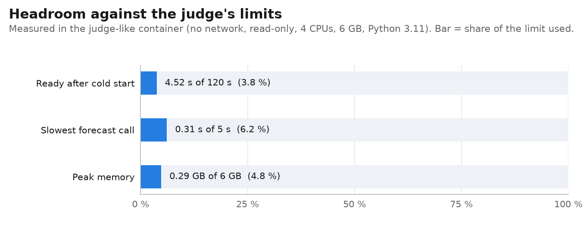
</picture>

| Measure (judge-like container, 120 calls) | Value | Judge limit |
|---|---|---|
| Ready after cold start | 4.5 s | 120 s |
| Forecast call, median / 95th percentile / slowest | 0.12 / 0.21 / 0.31 s | 5 s |
| Peak server memory | 0.29–0.44 GB | 6 GB |
| Same numbers as the development machine | max difference 0.0 | — |

---

## Testing and quality gates

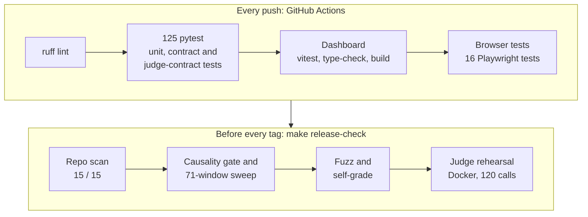

| Layer | Command | What it proves |
|---|---|---|
| **Unit and contract tests** | `make test` (CI) | Shapes, units, null shock, determinism, light cone (max-axis 8, Euclidean 9.66, judge radius), clamps, calibration, artifact hashes, no dates or route strings outside `serve.py`, HTTP edge cases. |
| **Judge-contract tests** | part of `make test` | The server starts from a **read-only** copy of only `serve.py`, `wethrfork/` and `artifacts/`, with the kit, HTTP clients and our own non-serve code made unimportable. The organisers' schema validator then passes. |
| **Judge rehearsal** | `make rehearsal` | The organisers' Stage 1 procedure on a clean copy of `git HEAD`. The server runs in a Python 3.11 container with **no network, a read-only filesystem, 4 CPUs and 6 GB**, and no kit. 120 calls are made with the organisers' client and scored with their code. |
| **Browser tests** | `make e2e` (CI) | The real dashboard in Chromium: maps, timeline, preset and drawn forks, live verdict, difference, swipe, point forecast, search, settings, pages, laptop and phone layouts. Fails on any page error or any request leaving the machine. |
| **Release check** | `make release-check` | Everything above plus the causality gate, the 71-window sweep, fuzz, the self-grade and the dashboard build. It exits 0 only if every step passes. Last run: **PASS in 78 s**. |

**The gates are proven to fail.** We built five broken copies of the server. Each was rejected:

| Broken copy | Caught by |
|---|---|
| Imports the organisers' kit (missing on the judge machine) | Server never becomes ready |
| Writes a file into the repository at start-up | Server never becomes ready (read-only) |
| Adds random noise to the forecast | Validity gate, schema validator, determinism, null shock |
| Sleeps 2 s per call | Strict latency gate (1.5 s) |
| Lets rain go negative | Validity gate, schema validator, contract probes |

Details: [`docs/10-testing-and-ci.md`](docs/10-testing-and-ci.md), thresholds in [`configs/rehearsal.yaml`](configs/rehearsal.yaml).

---

## Tech stack

| Layer | Technology |
|---|---|
| Model | PyTorch 2 (CPU, deterministic algorithms, 4 threads), NumPy; ridge regression, semi-Lagrangian advection, 3 × 3 CNN |
| Inference server | FastAPI, uvicorn; plain nested-list JSON; tolerates base64 input |
| Training and calibration | PyTorch (RTX 4050 laptop GPU), xarray, pandas, SciPy; per-lead blending, damping, rain quantile mapping |
| Evaluation | The organisers' kit (`monsoon_r1`: client, schema validator, scoring, repo scan), pytest, Docker |
| Lab server | FastAPI over the same engine plus the local dataset |
| Dashboard | React 18, TypeScript 5, Vite 5, Zustand, d3-contour; hand-written canvas renderer, particle advection, no map tiles |
| Base map | NASA Blue Marble imagery and Natural Earth 1:10m borders (India's point of view), both public domain and bundled |
| Quality | ruff, vitest, Playwright browser drives, GitHub Actions |

## Repository structure

```text
Wethrfork/
├── serve.py               judge entrypoint; the only file with the API route
├── wethrfork/             inference package: engine, network, ridge, blend, post-processor, clamps
├── artifacts/             committed weights, climatology, calibration, error maps, manifest with hashes
├── training/              data loading, ridge, both networks, blend, post-processor, error maps
├── evaluation/            self-grade, causality gate, sweep, fuzz, stress tests, dataset audit,
│                          judge rehearsal, release check, README charts
├── lab/                   lab server for the dashboard's science panels
├── dashboard/             React + Vite + TypeScript dashboard (src/components/map, src/components/tabs)
├── configs/               YAML configs; every date lives here, never in Python
├── tests/                 pytest suite, including the strict judge-contract tests
├── scripts/               demo launcher, preflight, base-map builder, screenshot capture
├── docker/                judge-like image and the grader image
├── brief/                 the two-page brief and its figures
├── docs/                  foundation documents, decisions, status, audit, images
└── vendor/                the organisers' kit wheel (development only, never imported by the server)
```

---

## Getting started

### Prerequisites

- Python 3.11 (3.10 or later works), Node 20 or later
- The organisers' dataset `india_climate_train.nc` and `stats.json` (kit release v1.0.0) for anything that needs real data
- Docker, only for the judge rehearsal

### 1. Install

```bash
python -m venv .venv && source .venv/bin/activate
pip install torch --index-url https://download.pytorch.org/whl/cpu
pip install -r requirements-dev.txt
pip install ./vendor/monsoon_r1_kit-1.0.0-py3-none-any.whl     # development only
mkdir -p data && cp /path/to/india_climate_train.nc /path/to/stats.json data/
```

### 2. Run what the judge runs

```bash
python serve.py --port 8000
python -m monsoon_r1.schema_validator http://localhost:8000     # in a second terminal
```

### 3. Run the full demo

```bash
make demo           # forecast server, lab server and dashboard, with checks; opens http://localhost:4173
bash scripts/demo.sh stop
```

### 4. Verify everything

```bash
make test                   # 125 tests, about 20 s, no dataset needed
make release-check          # every gate, strict; needs the dataset and Docker
make release-check-quick    # without dataset and Docker
```

### 5. Rebuild the model from scratch (optional)

```bash
make artifacts      # climatology, ridge, both networks, blend, post-processor, error maps, manifest
make selfgrade gate sweep fuzz
```

---

## Known limits

We state these with numbers instead of hiding them.

- **Responses are learned, not validated physics.** The architecture bounds *where* a change can appear, not whether
  it is physically right. Rain responses agree with observed warm-Bay composites (r = 0.31); pressure responses do not (r = −0.07).
- **A shock through the API is not the same as an edited input day.** The forecast of the unshocked state is kept and the
  dynamics network's response is added, as in tangent-linear forecasting. Over 71 windows the largest rainfall difference
  between the two routes has a median of 14.5 mm/day and a maximum of 105 mm/day (D41).
- **Day 8 is about climatology** by design, and heavy-rain skill is modest (CSI skill 0.073, 11 of 15 points).
- **The monsoon-stall rain response** follows the observed break-then-revival sequence but is about 2× the observed size by day 8.
- **Rare marginal causality misses:** 10 of 4,138 shocked forecasts over the whole archive (0.24 %) narrowly fail the
  judge's propagation check. The expected cost is about 0.01 point per judging window.
- **Resolution:** 1° daily fields cannot hold a cyclone's core, and energy that leaves the domain is lost.

## Roadmap

- [x] Speed-limited dynamics network with tested locality bound
- [x] Calibrated skill head that beats persistence and climatology
- [x] Live limits verdict and rainfall exposure in the dashboard
- [x] Judge-like rehearsal and strict release check
- [ ] Higher-resolution grid
- [ ] Learned sub-stepping, so faster jets (the Arabian Sea low-level jet) fit within the speed limit
- [ ] Transient-amplification regularisation for longer, steadier rollouts
- [ ] An ensemble perturbation model, to give every response an uncertainty range
- [ ] Data assimilation of fresh observations into the start state

## Documentation

| Document | Contents |
|---|---|
| [`AGENTS.md`](AGENTS.md) | Hard rules and workflow for anyone changing the code |
| [`docs/PRD.md`](docs/PRD.md) | Product requirements, users and success metrics |
| [`docs/ARCHITECTURE.md`](docs/ARCHITECTURE.md), [`docs/02-architecture-and-dataflow.md`](docs/02-architecture-and-dataflow.md) | System and data flow |
| [`docs/03-model-and-physics-spec.md`](docs/03-model-and-physics-spec.md), [`docs/09-ml-plan.md`](docs/09-ml-plan.md) | Model specification, training and calibration |
| [`docs/04-api-spec.md`](docs/04-api-spec.md) | Judge and lab APIs |
| [`docs/08-evaluation-and-scoring.md`](docs/08-evaluation-and-scoring.md) | How the judge scores, line by line, and how we self-grade |
| [`docs/10-testing-and-ci.md`](docs/10-testing-and-ci.md) | Test matrix, strict judge testing, CI |
| [`docs/DECISIONS.md`](docs/DECISIONS.md) | Every design decision with reasons (D1–D43) |
| [`docs/STATUS.md`](docs/STATUS.md), [`docs/AUDIT.md`](docs/AUDIT.md) | Current numbers, gates, audit and open issues |
| [`docs/05-demo-golden-path.md`](docs/05-demo-golden-path.md), [`docs/13-qa-prep-and-risks.md`](docs/13-qa-prep-and-risks.md) | Demo script, judge questions and risks |

## Credits and licence

- **Data:** `india_climate_train.nc` and `stats.json` contain modified ERA5 reanalysis data (Copernicus Climate Change
  Service; Hersbach et al., 2020), via WeatherBench 2 (Rasp et al., 2024), licensed CC BY 4.0. The data file is never committed.
- **Base map:** NASA Blue Marble imagery (public domain) and Natural Earth borders (public domain).
- **Scoring and contract:** the organisers' kit `yug-monsoon-kit` v1.0.0.
- **Code:** MIT licence, see [`LICENSE`](LICENSE). Built during Yugaantar DevForge by Team Return0.
