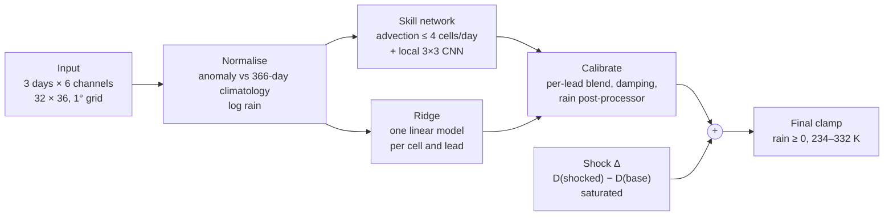
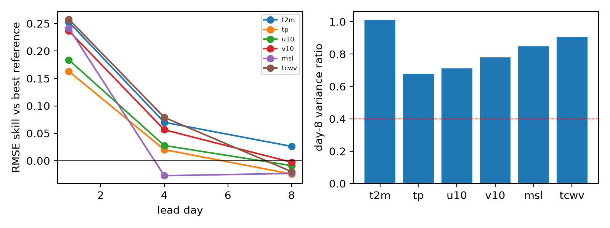
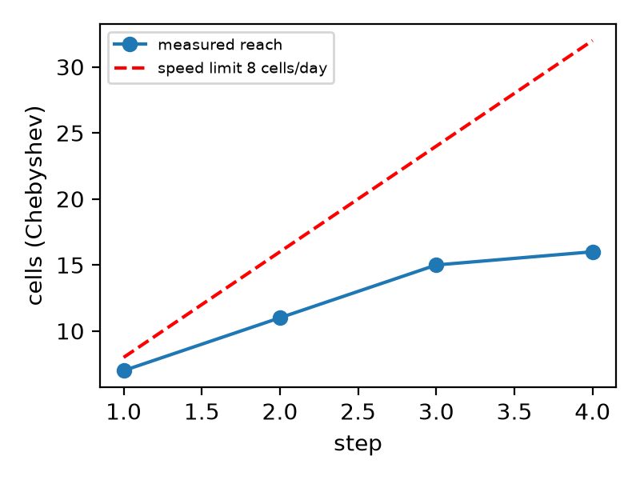
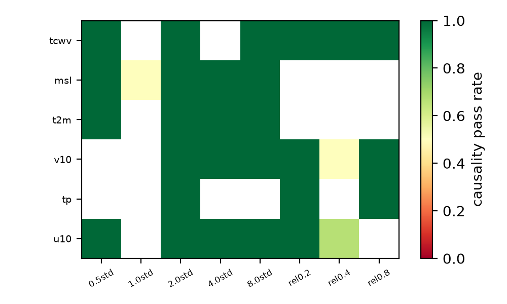
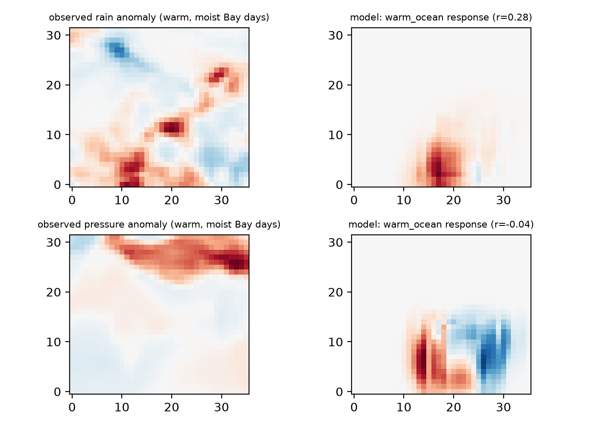
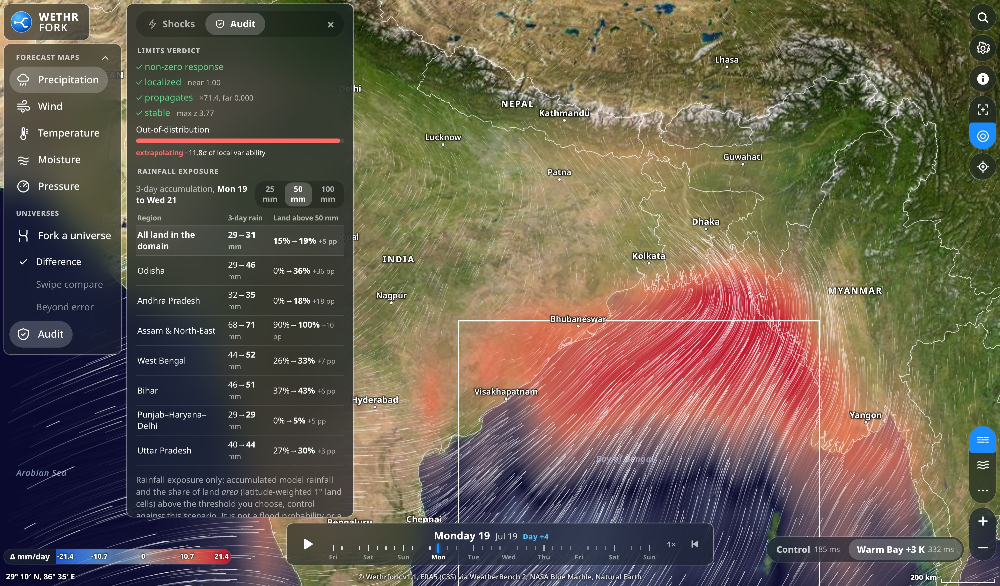

# Wethrfork: a weather model with a speed limit

**Yugaantar DevForge · Track 2 "Multiverse of Monsoon"** · Team Return0 · model `wethrfork-v1.1-speedlimit`
Repository: [github.com/HARDIKSINGH150206/Wethrfork](https://github.com/HARDIKSINGH150206/Wethrfork) ·
Print version: [`wethrfork-brief.pdf`](wethrfork-brief.pdf) (same content, 2 pages)

> **In one paragraph.** Wethrfork forecasts India's weather 10 days ahead and answers "what if" shocks. A calibrated
> forecast is paired with a separate dynamics network that computes only the change a shock causes. Each daily update
> can move a change at most **8 grid cells** along either axis (about 900 km), a bound our tests check. A shock
> therefore starts local and spreads at a bounded speed. On held-out data the model beats persistence and climatology,
> and every shock is audited live with the organisers' own checks. Responses are learned, not validated physics; we
> measure the limits and state them.

| 0.135 | 15 / 15 | 8 cells | 0.0 | 0.18 s |
| :---: | :---: | :---: | :---: | :---: |
| RMSE skill, held-out 2021 (full marks at 0.12) | causality in all 71 held-out windows | max reach per day, by construction | change from a zero shock (bit-identical) | 10-step shocked call, offline, 4 CPUs |

---

## 1. Model design and architecture



**Served formula**

```
out = clamp( PP( Blend(skill) ) + limit[ D(shocked) − D(base) ] )
```

This is a control forecast plus a perturbation model, as in tangent-linear forecasting.

- **One architecture, two networks.** Both have about 0.39 M parameters and run on CPU, deterministically.
- **Each step is residual on the last day.**
  - A semi-Lagrangian advection step comes first. Its displacement is capped at 4 cells/day with a smooth `tanh`.
  - Three 3×3 convolutions follow (reach 3), with replicate padding.
- **No global operations.** There is no attention, pooling, spatial normalisation, FFT or U-Net. So one update reaches
  at most **4 (advection) + 1 (bilinear) + 3 (convolutions) = 8 cells** along either axis.
- **A zero shock skips the shocked run.** The output is then bit-identical to the unshocked call.

---

## 2. Contract table: each judging criterion, the design that guarantees it, and the evidence

Evidence is from 2021, held out. The calibration was fitted on 2020.

| Judge criterion | Design property | Measured evidence |
| --- | --- | --- |
| Shock local on day 1, then spreads, never teleports | Reach ≤ 8 cells/step along either axis (≤ 9.7 diagonal), tested; pointwise response limiter | Both official shocks pass a gate stricter than the judge's in all 4 seasons (near ≥ 0.99, growth 20–3400×, far 0.000, max \|z\| ≤ 3.8). All 71 held-out windows score 15/15. Over every start day in the archive, 99.8% of shocked forecasts pass all four checks. |
| Zero shock changes nothing | Deterministic server; shocked run skipped for a null shock | Max difference 0.0 in every season, and in an offline, read-only, 4-CPU container |
| Valid outputs | Clamp applied after the delta: rain ≥ 0, 234–332 K | 200 fuzz shocks (random box or Gaussian, 6 channels, 0.5–8 std): 100% valid, 99.5% causal. 40 malformed or extreme API requests tested. |
| Beat persistence and climatology | Ridge + network blend per lead and channel; damping toward climatology | Mean RMSE skill **0.135** over 71 windows (day 1: 0.22, day 4: 0.04, day 8: −0.01) |
| Heavy rain (≥ 10 mm/day) | Log-space rain, wet-cell loss weight, per-lead rain shrink; floor and scale tuned on the per-window score | CSI skill **0.073** (day 1: 0.09, day 4: 0.02) |
| No blur | Residual dynamics; no loss that shrinks variance | Day-8 variance ratio 1.01 / 0.68 / 0.71 / 0.78 / 0.85 / 0.90 (t2m, tp, u10, v10, msl, tcwv); the judge's floor is 0.40 |
| Fast, offline | CPU, 4 threads; artifacts in the repo, SHA-256 checked at start-up | 10-step shocked call 0.18 s with JSON; ready in 3 s; repo scan 15/15 |

---

## 3. How we prevent drift and blur

**Drift.**
- The network is trained on a curriculum of 1, 4 and 8 unrolled days with input noise, so it learns from its own errors.
- Beyond a week the atmosphere is chaotic. The skill head is then about as good as climatology (day-8 skill −0.01), and
  we say so rather than hide it.

**Blur.**
- MSE-trained models smooth out rain. We counter this in three ways:
  - We keep rain in log space.
  - We weight wet cells 3×.
  - We tune the rain post-processor on a per-window score that penalises both false drizzle and missed events.
- An earlier version used quantile matching. It inflated rain variance and cost about 0.05 of mean skill, so we dropped it.



*Held-out 2021: RMSE skill by lead day and channel (left). Day-8 variance ratio (right); the dashed line is the
judge's floor, 0.4.*

---

## 4. Why the speed limit is real

<table>
<tr>
<td width="50%"></td>
<td width="50%"></td>
</tr>
<tr>
<td><em>Light-cone test: we change one cell and measure how far the change has travelled after 1–4 steps (max-axis
distance). It never travels more than 8 cells per step.</em></td>
<td><em>Stress test: 200 random shocks, 100% valid and 99.5% causal. White cells are combinations that were not
sampled.</em></td>
</tr>
</table>

---

## 5. Failure modes: what we know does not work

- **Jet transport.** The Arabian Sea low-level jet blows at 12–15 m/s (10–13 cells/day). That is faster than our 4-cell
  advection cap, so jet-driven transport is under-represented.
- **Responses are learned dynamics, not validated physics.**
  - Locality is bounded by design and tested. The sign and size of a response are learned.
  - A shock sent through the API is not the same as editing the input day and forecasting normally. Over 71 held-out
    windows, the largest rainfall gap between the two has a median of 14.5 mm/day (warm Bay), and reaches 105.
  - Natural experiment (60 warm, moist Bay days): our rain response has the same sign as the observed composite
    (r = 0.31). Our pressure response does not match (r ≈ 0).
  - A monsoon-stall shock first dries the west coast, then raises rain from day 4. Weak flow does the same in the data
    (a break followed by a revival). By day 8 our effect is about twice the observed size. This is a learned
    correlation, not a proven effect.
- **Extremes.**
  - The official `warm_ocean` shock is about 11.8σ of local variability, out of distribution, and it still passes.
  - The weakest fuzz categories are rain shocks (94%) and shocks of 40% of the current value (96%).
- **Grid and edges.**
  - 1° daily fields cannot hold a cyclone core.
  - Energy that leaves the domain is lost, so shocks at the edge spread less.



*Day-2 rain (top) and pressure (bottom). Left: the observed anomaly after warm, moist Bay days. Right: the model's
`warm_ocean` response. Each panel has its own symmetric colour scale. We show it because it only partly agrees.*

---

## 6. Visualisation: a weather map you can fork, audit and swipe

The dashboard draws live from our own forecast server. Nothing is pre-rendered, and it works with Wi-Fi off.



*Map view of a held-out monsoon window after forking a warm Bay of Bengal (+3 K, +15% moisture). It shows the
difference in rain at day +4 under live wind particles, with the day timeline.*
- *The white box is the shock.*
- *Left: the map menu, then the official causality checks running live on the shock, the out-of-distribution meter and
  the rainfall-exposure panel.*
- *Bottom: the timeline, the legend (left) and the run picker, control against universe (right).*

**Map.**
- It's styled like a satellite weather map, over a bundled NASA Blue Marble base with Natural Earth borders.
- Location search.
- Layers for wind, temperature, rain, pressure and moisture, with live particles and isobars.
- Click anywhere for a reading, then a detailed 10-day forecast.
- A day timeline.

**Beyond a weather map.**
- The difference between control and universe (delta), and a swipe compare of the two.
- Draw your own shock by dragging a rectangle.
- A sensitivity overlay showing where a value comes from.
- Three more pages:
  - **Timeline Prime:** forecast against reality, with error maps.
  - **Validation:** held-out skill, the gate, the fuzz test, the natural experiment and a live light-cone test.
  - **About.**
- A judge's new shock is answered in about 0.3 s.

---

## 7. Impact use case: rainfall exposure

**Question for a state disaster officer:** if the Bay of Bengal runs warm, how much more land is exposed to heavy
accumulated rain over the next three days?

The setup is the same held-out window and warm Bay shock as above:
- days +4 to +6;
- land cells only;
- a declared threshold of 50 mm over the 3 days.

This is model output, not a forecast of a real event.

| Region | 3-day rain | Land area above 50 mm |
| --- | ---: | ---: |
| Odisha | 29 → 46 mm | 0% → 36% (+36 pp) |
| Andhra Pradesh | 32 → 35 mm | 0% → 18% (+18 pp) |
| West Bengal | 44 → 52 mm | 26% → 33% (+7 pp) |
| All land | 29 → 31 mm | 15% → 19% (+5 pp) |

- Cells are 1° (about 110 km) and weighted by latitude, so each share is a share of land area.
- The threshold is chosen in the dashboard: 25, 50 or 100 mm.
- This is rainfall exposure only. It is not a flood probability or a crop-loss estimate.

---

## 8. Engineering and reproducibility

- **Offline, CPU-only, deterministic.**
  - The artifacts (about 21 MB) are in the repo and hash-checked at start-up.
  - We verified a clean clone in a container with no network, a read-only filesystem, 4 CPUs and 6 GB.
- **Honest splits.**
  - The network and the ridge were trained on 2005–2019.
  - The calibration was fitted on 2020 and graded on 2021, then refit on 2020–2021 for shipping; the network was not
    changed.
  - The reported skill is the held-out number. `make artifacts` reproduces everything.
- **Tested.** CI runs 125 tests, including 40 API edge cases and a strict judge-contract suite, plus the official repo
  scan.
- **Honest limits.** Day-8 skill is about climatology. The pressure response is not validated. Exposure is accumulated
  model rain, not a probability.

**Verify it yourself in about a minute**

```bash
make test                       # 125 tests in about 20 s, no dataset needed
python serve.py --port 8000     # the judge's entry point; then run the organisers' schema_validator against it
make release-check-quick        # every release gate that needs neither the dataset nor Docker
```

---

**Data.** Modified ERA5 reanalysis (Hersbach et al. 2020), from the Copernicus Climate Change Service, via Google
WeatherBench 2 (CC BY 4.0). Everything was built during the event. There is no lookup of past weather, and the
calibration files are statistics with no dates.

*Wethrfork v1.1 · related work: semi-Lagrangian advection in learned weather models (Learning to Advect);
tangent-linear perturbation forecasting.*
